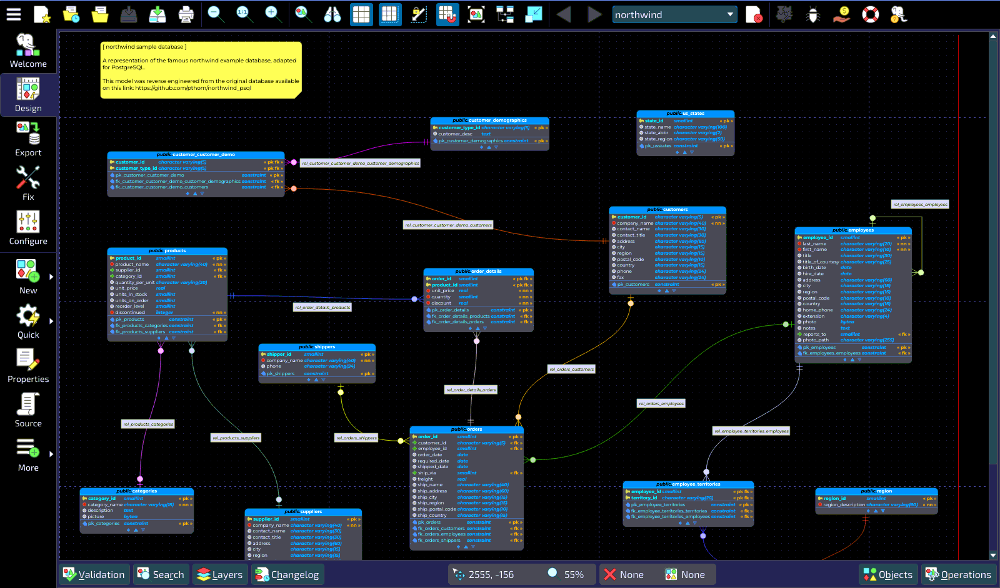
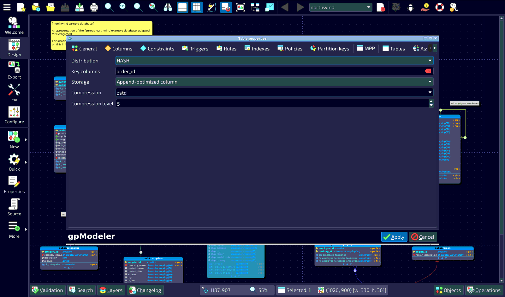
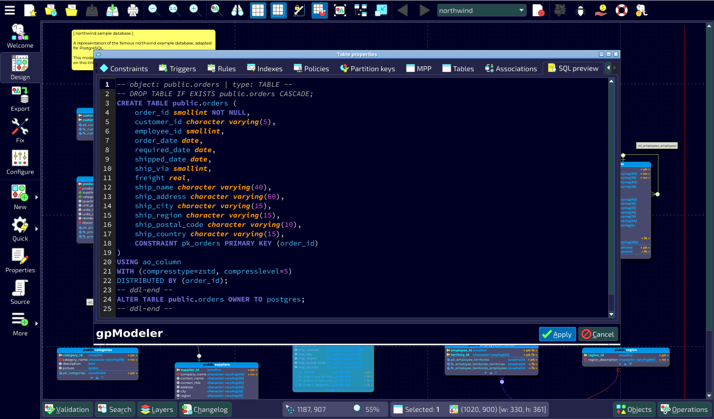

# gpModeler

[](https://github.com/gamesmod/gpmodeler/actions/workflows/windows-build.yml)
[](https://github.com/gamesmod/gpmodeler/actions/workflows/linux-build.yml)
[](https://github.com/gamesmod/gpmodeler/actions/workflows/macos-build.yml)
[](https://github.com/gamesmod/gpmodeler/releases/latest)


**gpModeler** — инструмент для проектирования баз данных **Greenplum** и **Apache Cloudberry**:
визуальное моделирование схемы, генерация DDL с учётом особенностей MPP-СУБД (распределение
данных, append-optimized и колоночное хранение, сжатие), экспорт модели в базу и сравнение
модели с живой базой.

Проект — форк [pgModeler](https://github.com/pgmodeler/pgmodeler) (GPLv3). Он не связан с авторами
pgModeler, Nullptr Labs, проектами Greenplum и Apache Cloudberry и не одобрен ими.

## Чем отличается от pgModeler

* **Тип сервера** задаётся для каждой модели: PostgreSQL, Greenplum 6 (синтаксис PostgreSQL 9.4),
  Greenplum 7 (PostgreSQL 12) или Apache Cloudberry (PostgreSQL 14). Выбирается в свойствах базы данных
  и сохраняется в файле `.dbm`.
* **Распределение таблиц**: `DISTRIBUTED BY (...)`, `DISTRIBUTED RANDOMLY`, `DISTRIBUTED REPLICATED`.
* **Хранение таблиц**: heap, append-optimized строковое и колоночное (`ao_row`, `ao_column`), PAX,
  с типом и уровнем сжатия. Для Greenplum 6 генерируется `WITH (appendonly=true, orientation=...)`,
  для Greenplum 7 и Cloudberry — `USING <access method>`.
* Сборки содержат `libpq` со всеми зависимостями: это единственный драйвер, который нужен
  gpModeler, потому что Greenplum и Cloudberry работают по протоколу PostgreSQL.
* Собственный каталог настроек (`gpmodeler-2.0`) и исполняемые файлы `gpmodeler`, `gpmodeler-cli`,
  `gpmodeler-ch`, `gpmodeler-se`.

В планах: секционирование GP/CB (`START/END/EVERY`), внешние таблицы и PXF, группы и очереди ресурсов,
обратное проектирование по каталогам `gp_*`.

## Скриншоты

Модель для Apache Cloudberry: диаграмма, свойства распределения и хранения таблицы,
сгенерированный DDL.







## Документация

Руководство по проектированию баз данных Greenplum и Cloudberry: [docs/README.md](docs/README.md).

## Загрузка

Готовые сборки прикреплены к [релизам](https://github.com/gamesmod/gpmodeler/releases) репозитория:

| Платформа | Файл | Как запустить |
|---|---|---|
| Windows 10/11 x64 | `gpmodeler-<версия>-win64.zip` | распаковать и запустить `gpmodeler.exe` |
| Linux x86_64 (glibc 2.35+) | `gpmodeler-<версия>-linux-x86_64.AppImage` | `chmod +x` на файл и запустить его |
| macOS 14+ (Apple Silicon) | `gpmodeler-<версия>-macos-arm64.dmg` | перетащить gpModeler в «Программы» |

Сборка для macOS подписана ad hoc и не нотарифицирована, поэтому при первом запуске macOS её
заблокирует. Откройте приложение через контекстное меню «Открыть» или выполните
`xattr -dr com.apple.quarantine /Applications/gpModeler.app`.

К каждому файлу приложен `.sha256` с контрольной суммой.

## Сборка

Требования: CMake 3.16+, компилятор C++17 с расширениями GCC/Clang (MSVC не поддерживается),
Qt 6.6+ (Core, Gui, Network, PrintSupport, Svg, Widgets), libpq и libxml2.

```sh
cmake -S . -B build -G Ninja -DCMAKE_BUILD_TYPE=Release -DPGM_PREFIX="$PWD/dist/gpmodeler"
cmake --build build --parallel
cmake --install build
```

Эталонные окружения описаны в workflow GitHub Actions, там же видны точные пакеты и шаги упаковки:

* Windows: MSYS2 с тулчейном clang, Qt и `libpq.dll` кладутся рядом с исполняемыми файлами,
  см. `.github/workflows/windows-build.yml`;
* Linux: Ubuntu 22.04, Qt из официальных сборок, AppImage через linuxdeploy,
  см. `.github/workflows/linux-build.yml`;
* macOS: Qt и libpq из Homebrew, бандл `.app` через macdeployqt,
  см. `.github/workflows/macos-build.yml`.

Иконки генерируются скриптом `assets/branding/gen_icons.py`.

## Выпуск релиза

Релиз выпускается тегом вида `v*`:

```sh
git tag v2.0.0 && git push origin v2.0.0
```

Второй способ — без тега: запустить workflow `Release` вручную на ветке `main` (Actions → Release →
Run workflow) и указать версию, например `v2.0.0`. Тогда тег создаст сам workflow на собранном коммите.

Workflow `Release` собирает все три платформы и публикует их в один релиз GitHub с автоматически
составленным списком изменений. Теги с суффиксом (`v2.0.0-beta1`, `v2.0.0-rc1`) публикуются как
pre-release. Ручной запуск `Release` без версии или отдельного workflow платформы только собирает
пакеты и прикладывает их к запуску как артефакты.

Бейджи вверху страницы показывают результат последней сборки каждой платформы на ветке `main`:
это ручные запуски workflow `Windows build`, `Linux build` и `macOS build`.

## Известные проблемы

Унаследованы от pgModeler:

* Очень большие модели (сотни таблиц) могут отрисовываться медленно из-за растрового движка Qt.
* Имена в верхнем регистре, со спецсимволами и зарезервированные слова всегда выводятся в кавычках.
* На очень больших экспортах и проверках модели в редких случаях ещё возможны гонки.

## Лицензия

gpModeler — свободное программное обеспечение, распространяется на условиях
**GNU General Public License v3**, см. [LICENSE](LICENSE). Он основан на исходном коде pgModeler.
Названия pgModeler и Nullptr Labs и их логотипы — товарные знаки Nullptr Labs; gpModeler не является
официальной сборкой pgModeler.
